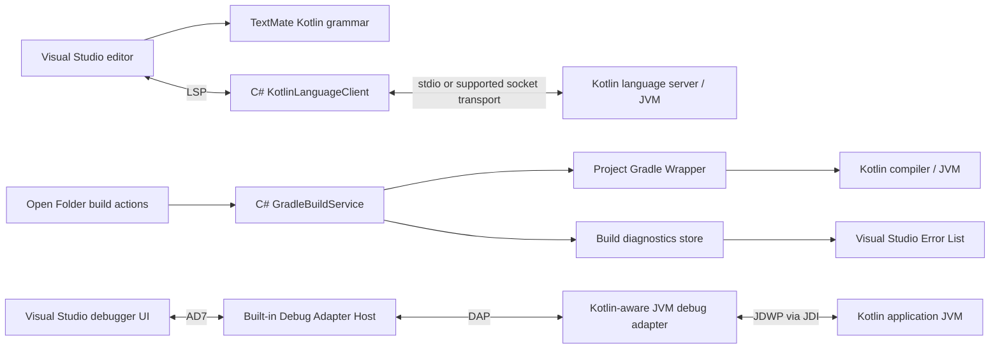

# Kotlin/JVM extension architecture

Implementation note: this remains the broader original design. Version 0.1.0 implements editing, navigation, Gradle diagnostics and JVM debugging described in the root README. Its tested installation target is VS 2026 18.12+; the original VS 2022 baseline below is a design proposal, not a compatibility claim for the current package.

## Implemented JVM debug path

The implementation reuses the official Kotlin server 263.7084.0 DAP backend instead of writing a separate JVM companion. Its release-specific launch contract is documented by the [official client source](https://github.com/Kotlin/kotlin-lsp/blob/kotlin-lsp/v263.7084.0/vscode-extension-core/src/dap.ts). The VSIX supplies the following SDK adapters:

| Class | Responsibility / extension point |
| --- | --- |
| `KotlinLaunchConfigurationProvider` | `ILaunchConfigurationProvider`, schema/defaults for `.vs/launch.vs.json` |
| `KotlinLaunchProvider` | `ILaunchDebugTargetProvider5`, native Open Folder F5/Ctrl+F5 routing |
| `KotlinDebugCoordinator` | Save/build gate, Gradle launch-model resolution, `IVsDebugger4.LaunchDebugTargets4` |
| `KotlinDebugLifecycle` | `IVsDebuggerEvents`, retain the shared server until the debugger returns to design mode |
| `KotlinLanguageClient.ImportNotifications` | Custom LSP import completion notifications; `ILanguageClientCustomMessage2` exposes the host's existing `JsonRpc` connection |
| `KotlinAdapterLauncher` | `IAdapterLauncher`, create a loopback DAP transport when Debug Adapter Host starts asynchronously |
| `KotlinDebugTransport` | `ITargetHostProcess`, duplex TCP streams, EOF/termination cleanup |
| `KotlinDapSourceStream` | Normalize backend file URIs to local paths expected by the host's source UI |
| `KotlinDapInputStream` | Assemble bounded, fragmented host frames before session processing |
| `KotlinDapSession` | Correlate host/backend requests, resolve pending object previews, order exit before termination |
| `KotlinEvaluation` | Adapt explicit host evaluations to the pinned backend's final-presentation path and bypass its expression cache |
| `KotlinServerCompatibility` | Set the native server's hover deadline at process startup, retaining the original restricted requests |
| `KotlinDebugCompletionListener` | `IVsTextViewCreationListener`, attach an `IOleCommandTarget` to native `DEBUGVIEW` and `COMMANDVIEW` editors |
| `KotlinDebugCompletionProvider` / `KotlinDebugCompletionSource` | MEF `ICompletionSourceProvider` / `ICompletionSource`, supply native `CompletionSet` lists through `ICompletionBroker` |
| `KotlinDebugCompletionController` | Resolve `EnvDTE.Debugger.CurrentStackFrame` locals/arguments/fields, handle insertion and dismiss on debugger-context changes |
| `KotlinCompletionQuery` | Parse bounded Kotlin name chains and replacement spans without evaluating receiver expressions |
| `KotlinDebugCompletionEntry` | `ICustomCommit`, replace the identifier with debugger-buffer write access scoped to the commit |
| `KotlinNativeCompletionSet` | `IVsCompletionSet` / `IVsTextView.UpdateCompletionStatus`, route native Watch commit and navigation keys through the SDK completion shim |
| `KotlinSemanticCompletion` | Build an isolated lexical source snapshot at the selected frame line, issue LSP completion and decode callable signatures without applying commands/edits |
| `KotlinMemberExtensions` | Select enclosing-owner extension candidates from validated DocumentSymbol ranges and decode compiler-resolved signatures |
| `KotlinCompletionIsolation` | Apply semantic owner rename results to analysis strings only, preserving source lines and excluding edits to other documents |
| `KotlinDebugDocumentFilter` | `ILanguageClientMiddleLayer2<JToken>`, prevent scratch-document diagnostics from entering Error List |

The two workspace exports are separate MEF parts: combining their metadata attributes on one class causes duplicate metadata keys. The engine and launcher are registered in `Registration/KotlinDebugAdapter.pkgdef`; the host maps DAP into native breakpoints, stack frames, variables and stepping.

Debugger completion is an IDE feature over native debug properties. Watch initially uses a `plaintext` buffer and `DEBUGVIEW`; Immediate uses `Command` and `COMMANDVIEW`, so the listener uses the SDK's `any` content type and explicitly restricts the view roles. While stopped in Kotlin, the Watch editor temporarily receives a dedicated content type derived from `code`, enabling the native completion shim. `IVsCompletionSet` and `IVsTextView.UpdateCompletionStatus` preserve Watch's native Tab/Enter routing. The original content type is restored on run/design mode, non-Kotlin context, or view closure. See the [SDK completion-set contract](https://learn.microsoft.com/en-us/dotnet/api/microsoft.visualstudio.textmanager.interop.ivscompletionset?view=visualstudiosdk-2022).

Immediate uses `ICompletionBroker` and a `CompletionSet`, restricted to the last input line with the `?` evaluation prefix. Its `ICustomCommit` temporarily clears `BSF_USER_READONLY` only around the identifier replacement and restores the original flags in `finally`; ordinary editor insertion otherwise fails in this debugger buffer. The same scoped buffer-write pattern is used by [Roslyn's debugger editor filter](https://github.com/dotnet/roslyn/blob/dd21600f51cf5464b4721b69ab1c8e86bfa0c101/src/VisualStudio/Core/Def/Implementation/DebuggerIntelliSense/DebuggerIntellisenseFilter.cs). IDE commands and command history are excluded.

The controller obtains the current frame for every new session, reads `Locals`, `Arguments`, and `Expression.DataMembers`, and never calls `GetExpression` or sends `evaluate` for suggestions. `DebuggerEvents` dismiss pending lists on context/run/design changes; view closure removes command filters and event handlers. Unrelated command-window bookkeeping must not dismiss the popup. See Microsoft's [completion extension walkthrough](https://learn.microsoft.com/en-us/visualstudio/extensibility/walkthrough-displaying-statement-completion?view=visualstudio).

Callable completion uses the existing LSP connection because the pinned standalone server exposes no DAP completion implementation. The IDE captures `EnvDTE90a.StackFrame2.FileName` and `LineNumber` on the UI thread. A background request copies the saved source and inserts the parsed receiver chain immediately before that one-based source line, followed by a statement separator. All surrounding declarations remain intact: local extensions, private members, generic parameters/bounds, explicit and inferred types. Kotlin resolves visibility and substitutions; the extension neither parses generic signatures nor guesses them from erased JVM presentations. Native property lists use `Locals2[false]`/`Arguments2[false]` to disable implicit property/function evaluation.

A stable per-source `__VistudioDebugCompletion_<hash>.kt` URI in the source directory gives the server the imported Gradle module context. `didOpen` supplies the copy without a disk file; `textDocument/completion` performs analysis; `didClose` runs in `finally`, including on cancellation/error. A per-client semaphore serializes the complete request lifetime across debugger windows. The primary completion snapshot has a stable identity; isolated member probes described below have separate identities. Empty `isIncomplete` responses are requeried up to three times, 200 ms apart, with LSP trigger kind 3 while the same document remains open; the existing cancellation/deadline applies. No expression evaluation is retried. Original host-owned source buffers, versions and files are untouched. Copies can still coexist with their original top-level declarations; ambiguous module shapes and line-only placement inside multiline expressions remain limitations, not claims of exact evaluator equivalence.

Requests debounce for 150 ms with a five-second cancellation deadline. The controller cancels on edits, dismissal, loss of focus, frame/run/design changes and closure. Before publishing asynchronous results it checks request identity, break mode, focus, exact snapshot and caret position. Results are not cached across frames. Local/field suggestions remain available if semantic analysis is unavailable. Generated-document diagnostics are suppressed by the SDK middle layer.

Enclosing generic owners need an additional analysis path on the tested backend. Repeated copies with the same owner identity can omit extensions on `T` and `List<T>`, even with incomplete-list retries and signature help. `documentSymbol` identifies at most 32 matching direct member-extension names of enclosing owners. `textDocument/rename` supplies bound-reference edits for up to eight enclosing owners; only validated, nonoverlapping single-line edits to the virtual URI are used, at most 512 total. Other-document edits are ignored. Nothing is applied to Visual Studio, the workspace, or disk. The resulting analysis template preserves the Kotlin scope, bounds, imports, private access and self references without a C# type inference approximation.

Each candidate gets a fresh virtual document and a distinct renamed owner identity. The only inserted expression is a receiver/name/open-parenthesis probe; `signatureHelp` resolves applicability and overloads, then the probe is closed in `finally`. Display signatures restore original owner names; commit inserts only the function identifier. At most two virtual documents coexist within the serialized request. The shared five-second deadline still applies. Missing optional symbol/rename/signature features retain ordinary completion. The new [real-server frame validation](validation.md#enclosing-class-generic-extension-fix) covers two bounded generic owners and repeated caller selection; native UI acceptance of this change remains pending.

The pinned server returns callable labels/signatures and an opaque `jetbrains.kotlin.completion.apply` command. The extension never executes that command or applies workspace edits: it filters to callable entries and already-in-scope top-level extension origins, preserves overload descriptions, and inserts only the escaped identifier. Local extensions have no package origin. Private member extensions arrive as Method with an enclosing-class origin; their accessibility is resolved by Kotlin, not by import filtering. Ordinary completion can omit member extensions on the enclosing class's own generic parameter (`T`/`List<T>`); the bounded owner-isolation and signature-help path above addresses the tested cases. Private extensions with their own function-level parameter also remain supported. The server's operator kind 24 is retained, including `List<T>.get` with a substituted result type. Watch must advertise `CSF_CUSTOMCOMMIT`/`CSF_CUSTOMMATCHING` so the shim invokes `OnCommit` instead of inserting the entire display signature. Its custom commit returns `S_FALSE` for identifier characters so typing continues to filter. See the [SDK completion flags](https://learn.microsoft.com/en-us/dotnet/api/microsoft.visualstudio.textmanager.interop.updatecompletionflags?view=visualstudiosdk-2022) and [OnCommit contract](https://learn.microsoft.com/en-us/dotnet/api/microsoft.visualstudio.textmanager.interop.ivscompletionset.oncommit?view=visualstudiosdk-2022).

`KotlinDapSession` re-reads only object-valued `variables` entries whose backend presentation is still `Collecting data…`, at 50 ms intervals within a two-second budget. The response retains the host's original request ID and the backend's expansion handles. It does not re-evaluate expressions or cache values across suspension generations. Request IDs, cancellation targets and reverse responses are translated, and each side receives increasing sequence numbers. Malformed framing closes the transport.

The session holds an early `terminated` event for at most five seconds, forwarding intervening output. A real `exited` event is delivered first with its code unchanged, followed by termination. EOF, Stop Debugging and timeout release the held event without inventing a successful exit. Exactly one backend read remains active across that timeout. These adaptations address the tested server's asynchronous presentations and event order; they do not replace the [DAP lifecycle](https://microsoft.github.io/debug-adapter-protocol/overview.html) or implement a new JVM debugger.

Native Watch and Immediate use the host's DAP `evaluate` requests. `KotlinEvaluation` changes unrestricted `watch`, `variables`, `repl`, and omitted contexts to `repl`: server 263.7084.0 awaits final presentation there, whereas its watch path may return `Collecting data…`. Visual Studio 18.12 omits `context` for Immediate commands, as confirmed in the real host log. The server also caches results by raw expression and frame, including for `repl`; a unique trailing newline/comment per request prevents stale results on repeated explicit evaluation. The original Kotlin text is preserved and is not wrapped in another scope. Each host request causes exactly one backend evaluation, with no retry. The selected frame, format, timeout, result type, expansion handles and structured failures remain intact.

Hover, unknown contexts and requests marked `noSideEffects` or `noFuncEval` are not promoted or rewritten. These are release-specific compatibility adjustments, not a C# implementation of Kotlin semantics. The external Kotlin/JVM evaluator owns parsing, name lookup and execution; the LSP client supplies the shared server connection and launch model, not expression results. Visual Studio owns Watch, Immediate, frame selection and refresh behavior. Relevant host contracts: [evaluation arguments](https://github.com/microsoft/VSDebugAdapterHost/wiki/Evaluation-Arguments) and [timeouts](https://github.com/microsoft/VSDebugAdapterHost/wiki/Evaluation-Timeouts). Forwarding a timeout or restriction does not establish backend enforcement; advanced timeout/cancellation behavior still needs acceptance tests.

Saved Watch expressions arrive from VS 18.12 as `hover` with `noSideEffects: true` and a 5000 ms host deadline. The pinned server's `DapEvaluateManager` applies its own 500 ms hover deadline, independent of that request field. `KotlinServerCompatibility.Configure`, called before the native server starts, adds `-Ddap.evaluate.hover.timeout.ms=4000` to its child-only `IJ_JAVA_OPTIONS`. This allows cold Kotlin compilation while retaining time for transport/presentation within the host budget. The IntelliJ [registry implementation](https://github.com/JetBrains/intellij-community/blob/master/platform/util/src/com/intellij/openapi/util/registry/RegistryValue.kt) supports system-property values; the installed 263.7084.0 binary was also inspected for this behavior and the exact timeout key. No request is replayed, promoted to repl, or stripped of restrictions to recover a timeout. A genuinely slow evaluation still has a bounded deadline and its failure is returned without a retry.

This startup adjustment applies only to `intellij-server.exe`. Existing `IJ_JAVA_OPTIONS` are retained, including an explicit value for the timeout key. No persistent machine environment, server files, Gradle JVM options or dependency versions are changed. Other/custom launchers are outside this compatibility adjustment.

F5 first runs the existing Gradle build/diagnostics pipeline and proceeds only on exit 0. It waits for server import, calls `intellij.java.resolveBuildToolLaunch`, obtains a DAP endpoint with `start_debug_server`, and supplies `buildToolTarget` to DAP launch. The server runs the target using a Gradle JavaExec task and the project's toolchain/runtime dependencies. The second Gradle invocation performs the actual debug run. No cache scanning, generated MSBuild project, manual JDWP connection or fixed debug port is used.

`LaunchDebugTargets4` can return before the custom launcher connects. The launch JSON therefore carries the server's loopback port, and transport creation occurs inside `IAdapterLauncher`; sockets are not shared through process-global registries. Stop sends DAP disconnect with termination through the native host. Closing the IDE also stops the owned server job and its descendants. Manual LSP restart is rejected while a debug session retains that server.

## Compose preview path

| Class / file | Responsibility |
| --- | --- |
| `ComposePreviewScanner` (Core) | Lexical `@Preview` discovery (comments/strings masked), arguments, JVM facade class, renderer request, results manifest |
| `GradleCommand.CreatePreview` (Core) | Fixed init-script task with paths in environment variables |
| `Build/ComposePreview.gradle` | Picks the project owning the file and the JVM target whose main compilation contains it, compiles the renderer, runs it on that compilation's outputs and runtime classpath |
| `Build/VistudioPreviewRenderer.java` | JDK-only renderer in its own JVM: reflective `ImageComposeScene` construction, composable invocation through a `Function2` proxy, Skia PNG encoding, cropping, background, per-preview errors |
| `ComposePreviewRunner` | Settings and Gradle root resolution, output folder, process run, failure summary |
| `ComposePreviewWindow` | `ToolWindowPane`; follows `SEID_DocumentFrame`, re-renders on `OnAfterSave`, shares the package's Gradle gate (`RunExclusiveGradleAsync`) |

The IDE never loads Compose: the user's Gradle build compiles the module and the renderer uses the module's own Compose and Skia versions. Reflection uses only stable shapes (the `(Composer, int)` signature of a parameterless composable, `ImageComposeScene` constructors matched by parameter type, Kotlin's `encodeToData$default` bridge), so no Compose version is pinned by the extension.

## CodeLens path

`Vistudio.Core/CodeLens/CodeDeclarationScanner` finds Kotlin and Java declarations lexically (no VS dependencies). The VSIX hosts VisualStudio.Extensibility parts in-process (`VssdkCompatibleExtension`, manifest type `VSSDK+VisualStudio.Extensibility`): `JvmCodeLensTaggerProvider` emits `CodeLensTag`s for `.kt`/`.java` views, and four `ICodeLensProvider`s add references, implementations, Run and Debug lenses. Counts are `textDocument/references` / `textDocument/implementation` sent through the owning language client (`KotlinLanguageClient.RequestAsync`, `JavaLanguageClient.RequestAsync`); clicks run Visual Studio's Find All References / Go To Implementation at the name, which the same LSP client answers. Run and Debug call `KotlinDebugCoordinator.LaunchAsync` with `noDebug`. The parts apply to the `text` document type and filter by extension, because Visual Studio sets the Kotlin/Java content type after the view opens. Evidence: [codelens-validation.md](codelens-validation.md).

Further lens kinds (`JvmCodeLensKinds.cs`) use scanner traits carried in the code element identifier (`CodeLensElement`: `Function/5` = kind plus `CodeDeclarationTraits`). Override bases: Kotlin LSP answers no "go to super", so the lens sends `textDocument/prepareTypeHierarchy` at the member and walks `typeHierarchy/supertypes`, scanning each supertype's source (`file:` or a `jar:` sources jar, `KotlinSourceSets.ReadSource`) for the member. `expect` → actuals is `textDocument/implementation`; `actual` → `expect` is found by `KotlinSourceSets.FindExpect` in the module's other `src/<set>/` folders. "Show preview" opens `ComposePreviewWindow` through the package. Gradle script tasks come from `GradleScriptScanner` (tagged in `.gradle.kts` views) and run through `KotlinPackage.RunScriptTasksAsync` in the script's own build (nearest `settings.gradle(.kts)`), behind the shared Gradle gate.

Inlay hints are drawn by Visual Studio's LSP client (`textDocument/inlayHint`, resolve, refresh). `InlayHintsViewOptions` sets the `EnableInlayHints` editor option on Kotlin/Java views (Visual Studio defaults to showing hints only while Alt+F1 is held). Kotlin LSP 271 asks `workspace/configuration` for section `jetbrains.kotlin` before each request and returns no hints for a null answer; Visual Studio answers that request only from Open Folder workspace settings, and an LSP middle layer sees only client-to-server traffic. `LspConfigurationReader` therefore wraps the server output, answers that section with the flat option-id object from `InlayHints.KotlinOptions`, and writes the response through `KotlinInitializeStream.InjectAsync`, which places it between client frames; every other frame passes unchanged. JDT LS gets `java.inlayHints` in its initialization options. Middle layers normalize results: whitespace-only hints become padding and hints without a kind get one. Probe: `tests/integration/verify-inlay-hints.py`.

The remaining sections preserve the original design options and broader acceptance goals. Consult [validation.md](validation.md) for the implemented and tested boundaries.

## Scope and deliverable

This document specifies a classic Visual Studio VSIX written in C#. It is a design with illustrative code, not a completed extension. The user selected architecture and key C# fragments as the deliverable.

The first supported runtime is Kotlin/JVM. A generic promise of Kotlin debugging would also imply Native, JS, and Android backends, which require separate designs. Syntax coloring may work for their files without implying build-model or debugger support.

Two toolchains must remain distinct:

| Layer | Toolchain |
| --- | --- |
| C# VSIX development | Visual Studio SDK, compatible .NET Framework target, VSIX build tooling; MSBuild may build the extension |
| User Kotlin project | Project's Gradle Wrapper, compatible JDK, Kotlin Gradle plugin; JVM bytecode and JARs |

No generated C# projects, MSBuild imports, Roslyn workspace, or CLR debug engine are involved in compiling or running Kotlin.

Use Open Folder as the primary workspace model. There is no need to write a project system merely to expose Kotlin files or language features. The extension's own solution is unrelated to the user's Gradle project. If solution-based project nodes are added later, they need a separate non-MSBuild project system and separate LSP integration validation.

## Components



LSP, DAP, and JDWP are different protocols and have separate sessions and ports. LSP completion cannot implement debugging. A JDWP socket cannot be handed directly to Debug Adapter Host.

## Proposed solution layout

The following tree describes future implementation files; it is not a list of files already generated.

```text
Vistudio.sln                         # Extension development only
src/
  Vistudio.Vsix/
    source.extension.vsixmanifest
    KotlinPackage.cs
    Commands.vsct
    Options/KotlinOptionsPage.cs
    Editor/KotlinContentTypes.cs
    Language/KotlinLanguageClient.cs
    Language/LanguageServerSession.cs
    Workspace/GradleWorkspaceService.cs
    Workspace/GradleFileScanner.cs
    Workspace/GradleFileContextProvider.cs
    Workspace/GradleBuildActionProvider.cs
    Workspace/KotlinLaunchConfigurationProvider.cs
    Workspace/KotlinLaunchDebugTargetProvider.cs
    Diagnostics/BuildErrorListDataSource.cs
    Diagnostics/BuildErrorSnapshot.cs
    Debug/KotlinDebugSessionCoordinator.cs
    Debug/KotlinAdapterLauncher.cs
    Grammars/Kotlin.tmLanguage.json
    Registration/KotlinGrammar.pkgdef
    Registration/KotlinDebugAdapter.pkgdef
  Vistudio.Core/
    Gradle/GradleBuildService.cs
    Gradle/KotlinDiagnosticParser.cs
    Gradle/GradleProjectModel.cs
    Processes/OwnedProcessSession.cs
    Diagnostics/BuildDiagnostic.cs
    Debug/DebugLaunchProfile.cs
    Debug/DebugSessionState.cs
  kotlin-debug-adapter/              # JVM companion, proposed separate Gradle build
    src/main/.../DapServer
    src/main/.../JdiSession
    src/main/.../KotlinSourceMapper
    src/main/.../BreakpointManager
    src/main/.../VariablePresenter
    src/main/.../KotlinExpressionEvaluator
tests/
  core/                             # Parsing, cancellation, session state
  protocol/                         # LSP/DAP compatibility and lifecycle
  vs-integration/                   # Experimental instance
samples/
  kotlin-jvm-gradle/                # Standalone Gradle project
```

The JVM companion is an architectural choice to reuse JDI. If every component must be C#, replace JDI with a C# JDWP implementation; that adds substantial debugger-protocol work. Neither backend is implemented in this deliverable.

## Visual Studio SDK extension points

The user explicitly selected Visual Studio SDK. Use the classic in-process VSSDK extension model with `AsyncPackage` and MEF. The proposed SDK references below describe that model; they do not introduce an alternative extension framework.

| Responsibility | Proposed class | SDK contract / registration |
| --- | --- | --- |
| Package lifecycle | `KotlinPackage` | `AsyncPackage`, `PackageRegistration(AllowsBackgroundLoading = true)`, `ProvideMenuResource` |
| Commands and options | Package commands, `KotlinOptionsPage` | `.vsct`, `OleMenuCommandService`, `DialogPage`, `ProvideOptionPage` |
| Recognize files | `KotlinContentTypes` | MEF `ContentTypeDefinition`, `FileExtensionToContentTypeDefinition` for `.kt` and `.kts` |
| Language features | `KotlinLanguageClient` | MEF `ILanguageClient`, content type derived from `CodeRemoteContentDefinition.CodeRemoteContentTypeName` |
| Lexical coloring | Kotlin TextMate grammar | `TextMate\Repositories` registration in `.pkgdef`; grammar packaged as VSIX content |
| Active folder | `GradleWorkspaceService` | `IVsFolderWorkspaceService`, workspace change notification |
| Build discovery | `GradleFileScanner`, `GradleFileContextProvider` | `IFileScanner`, `IFileContextProvider`, corresponding MEF provider factories |
| Build/Clean/Rebuild | `GradleBuildActionProvider` | `IFileContextActionProvider`, `IFileContextAction`, `IVsCommandItem`, `BuildContextTypes` |
| Build diagnostics | `BuildErrorListDataSource` | `ITableDataSource`, `ITableEntriesSnapshotFactory`, `ITableEntriesSnapshot`, Error List table manager |
| Small diagnostic prototype | `BuildErrorListPresenter` | `ErrorListProvider`, `ErrorTask` |
| Build log | `GradleBuildService` VS adapter | `IVsOutputWindow`, `IVsOutputWindowPane` |
| F5 target discovery | Kotlin launch providers | `ILaunchConfigurationProvider`, `ILaunchDebugTargetProvider`, corresponding export attributes |
| Debugger integration | `KotlinAdapterLauncher` | Debug Adapter Host, `IAdapterLauncher`, `ITargetHostProcess`, engine `.pkgdef` |

Use UI-thread switching only around APIs that require it, through the package's JoinableTaskFactory. Process I/O, build waits, and protocol sessions must not block the UI thread. Dispose event subscriptions and workspace resources on folder changes.

Package both the VSPackage and MEF component assets. Include grammar and registration files in the VSIX. Select SDK package versions against the oldest supported Visual Studio host; do not blindly ship private replacements for assemblies supplied by the IDE.

## Highlighting, IntelliSense, and navigation

Use a TextMate grammar for immediate lexical coloring, including nested block comments, raw strings, interpolation, annotations, backtick identifiers, and keywords. A few regular expressions matching keywords do not constitute a Kotlin grammar. If a custom classifier is later needed, the native editor path is `IClassifierProvider` / `IClassifier`; do not run competing classifiers over the same spans.

`KotlinLanguageClient` connects the IDE to an independently installed Kotlin language server. `LanguageServerSession` owns transport, stderr logging, startup failure reporting, and process disposal. Only protocol bytes may enter stdout when using stdio. The launcher must follow the selected server release's actual CLI and transport; do not invent a `java -jar server.jar --stdio` command.

The proposed backend is JetBrains' Kotlin LSP, subject to compatibility and distribution review. Its official repository currently labels it Alpha and partially closed source, so redistribution and feature promises need release-specific checking. Gradle/JVM import is relevant to this design; its VS Code extension is not installable in classic Visual Studio. See [Kotlin LSP](https://github.com/Kotlin/kotlin-lsp).

VS owns document synchronization and UI for completion, hover, signature help, definitions, and references; the server supplies semantic results. Do not implement a second text-document synchronization client. Project roots, dependencies, source sets, and JDK must reach the server through supported initialization/import behavior. Full-file syntax support for `.gradle.kts` does not prove semantic Gradle Kotlin DSL completion.

Test `textDocument/completion`, `completionItem/resolve`, `textDocument/hover`, `textDocument/signatureHelp`, `textDocument/definition`, and `textDocument/references` against the pinned client/server pair. Note that the standard resolve method is `completionItem/resolve`, even where older overview tables abbreviate it. Inspect initialization capabilities; support for every newer LSP feature must not be assumed. Validate position encoding, URI conversion, unsaved edits, workspace settings, and server-specific requests. Optional custom requests use `ILanguageClientCustomMessage2`.

F12 and Find All References should use the built-in LSP UI. Include tests for cross-module symbols and dependency sources. On folder switch, stop the previous session and clear its state; a single global server must not silently keep the previous project's classpath. On process failure, show a useful status and allow a bounded restart.

Primary references: [LSP integration](https://learn.microsoft.com/en-us/visualstudio/extensibility/adding-an-lsp-extension), [ILanguageClient lifecycle](https://learn.microsoft.com/en-us/dotnet/api/microsoft.visualstudio.languageserver.client.ilanguageclient?view=visualstudiosdk-2022).

## Gradle builds without MSBuild

`GradleWorkspaceService` associates the opened folder with an explicit Gradle root. Check `settings.gradle(.kts)`, the wrapper, and included builds; do not assume that the active file's closest `build.gradle.kts` is the root of a multi-module build. Let users select the build root and task when several builds are present.

`GradleBuildService` runs the project's wrapper in that root:

```text
gradlew.bat --console=plain build
gradlew.bat --console=plain :app:build
gradlew.bat --console=plain clean build
gradlew.bat --console=plain test
```

Map Clean to `clean`, Rebuild to `clean build`, and ordinary Build to the chosen build task. Task paths must be configurable. Never fall back silently to a global Gradle version. Report a missing wrapper or JDK with an actionable message.

Use concurrent stdout/stderr draining, bounded/batched UI output, cancellation, and an exit-code-based result. A process exit with code zero is success; an absence of parsed errors is not. A failed build without a parsed compiler message gets a summary Error List entry and a link to the output.

On Windows a batch wrapper requires deliberate `cmd.exe` handling; never concatenate untrusted task names or JVM options into a command. For simple task commands, validate task tokens, invoke the fixed wrapper name, and pass the directory through `WorkingDirectory`. A richer argument model needs tested shell quoting or a JVM-side launcher. JDK paths belong in process environment/configuration, not interpolated shell fragments.

Cancellation must terminate the owned invocation and its descendants. Do not kill all `java.exe` processes or globally stop other projects' Gradle daemons. A Windows Job Object can own the invocation tree; a Gradle Tooling API bridge can provide cooperative cancellation. A surviving shared daemon requires explicit handling rather than assuming killing `cmd.exe` cancels every build action.

For source roots, runtime classpath, and launch metadata, use a versioned Gradle-side model exporter/Tooling API bridge. Do not infer all dependency JARs by scanning caches or assume every module uses the default source layout. Run arbitrary project Gradle logic only in the user's trusted workspace context.

Open Folder integration uses indexed build configurations and file-context actions, so native build commands need more than a menu handler. The context and indexed configuration IDs must agree. The simpler first integration may offer explicit Kotlin build commands while the indexed provider is being implemented; it must not claim native Build menu integration yet. [Microsoft's workspace build contracts](https://learn.microsoft.com/en-us/visualstudio/extensibility/workspace-build?view=visualstudio).

## Error List

Keep two independent owners: editor diagnostics published through LSP, and compiler/build diagnostics published by this extension. Clearing the current build must not remove another extension's rows or the LSP server's current diagnostics.

`KotlinDiagnosticParser` supports tested compiler output variants, such as URI-plus-line/column and older parenthesized locations. Normalize file URIs, spaces, drive letters, relative paths, and one-based compiler coordinates. Preserve severity and multiline messages. Unrecognized output remains visible in Output; parser failure must never turn a failed build into success.

The production store is keyed by workspace, build generation, file, position, severity, and message. Publish immutable snapshots; reject late output from an older generation. Replace only the build rows for the rebuilt scope. Invalidate stale build results when relevant documents change and mark source mismatch rather than presenting old positions as current.

Use the table APIs for source labels, stable row identities, large result sets, and navigation. `ErrorListProvider` / `ErrorTask` is enough for the small fragment. In an Open Folder-only implementation, `IBuildMessageService.ReportBuildMessages` is another supported route; choose one publisher for a given build to avoid duplicate rows. Wire double-click navigation and convert stored coordinates to the API's coordinate convention. [ErrorListProvider](https://learn.microsoft.com/en-us/dotnet/api/microsoft.visualstudio.shell.errorlistprovider?view=visualstudiosdk-2022).

## Debugging inside Visual Studio

Debug Adapter Host maps DAP sessions into Breakpoints, Call Stack, Locals, Watch, Threads, stepping, and exception UI. Register a dedicated engine GUID in `.pkgdef` and use `IAdapterLauncher` when startup or transport needs custom control. The launcher returns DAP streams through `ITargetHostProcess`, not a JDWP connection. [Host integration](https://github.com/microsoft/VSDebugAdapterHost/wiki), [custom transport](https://github.com/microsoft/VSDebugAdapterHost/wiki/Providing-a-Custom-Transport).

There is no generic Kotlin debugger supplied merely by selecting a Kotlin language server. Microsoft's Java debug server is a candidate foundation, but its documented setup uses JDT LS and JDI. It is not a standalone `java -jar` Kotlin debugger, and Kotlin expression/source-map support cannot be inferred from Java support. [Java debug server](https://github.com/microsoft/java-debug).

The proposed reliable boundary is a Kotlin-aware JVM DAP companion, implemented or adapted and validated separately. Its minimum responsibilities are:

| DAP feature | JVM/Kotlin work |
| --- | --- |
| initialize / attach / disconnect | Session and capability negotiation, JDWP connection, owned-process policy |
| setBreakpoints | Resolve `.kt` source to JVM classes and line locations; keep pending breakpoints for classes loaded later |
| configurationDone | Resume an initially suspended VM only after initial breakpoint configuration |
| threads / stackTrace | JDI thread/frame inspection and original Kotlin source locations |
| scopes / variables | Stable handles, lazy expansion, locals and fields; invalidate frame handles on resume |
| continue / next / stepIn / stepOut / pause | JDI event and suspend policy management; filter generated code as appropriate |
| evaluate | Explicitly distinguish local-variable lookup from a Kotlin expression evaluator |
| exceptions | Convert supported exception break modes and emit consistent stopped events |

`KotlinSourceMapper` must consume JVM line metadata and Kotlin SMAP / SourceDebugExtension information where present. Multiple generated classes, top-level functions, lambdas, inline call sites, and coroutine state machines prevent a naive filename-to-class mapping. A breakpoint with no executable location stays unverified with a reason. Kotlin coroutine logical stacks and arbitrary expression evaluation require additional Kotlin-aware work; they must be advertised only when implemented and tested.

The F5 coordinator uses this sequence:

1. Resolve workspace, run target, JDK, adapter, and launch profile; save relevant documents or apply an explicit unsaved-buffer policy.
2. Build via Gradle. Stop on failure and display diagnostics.
3. Launch the target through the selected Gradle `JavaExec` task in debug mode, or through Java with the Gradle-exported runtime classpath.
4. Start the JVM suspended with a loopback JDWP endpoint, for example `-agentlib:jdwp=transport=dt_socket,server=y,suspend=y,address=127.0.0.1:5005` on a compatible JDK.
5. Detect readiness from the owned target/launch protocol and handle timeout or early exit. Do not consume the single JDWP connection with a throwaway TCP probe.
6. Start DAP through the Host and send `attach` with the JDWP host/port and source paths in the adapter's own schema.
7. Let the Host perform DAP initialization and breakpoint configuration. Resume through the adapter after configuration is complete.
8. On Stop, detach or terminate according to session ownership; dispose adapter and launch resources even on failure.

For Gradle's Application plugin, `gradlew.bat :app:run --debug-jvm` provides a useful starting point. Keep its process running while attaching: waiting for the suspended application's Gradle task to finish would deadlock startup. Test debugging uses a separate `Test` task configuration, usually one worker. `-Dorg.gradle.debug=true` debugs Gradle itself, not the target application. [Application plugin](https://docs.gradle.org/current/userguide/application_plugin.html), [test debugging](https://docs.gradle.org/current/userguide/java_testing.html), [Gradle process debugging](https://docs.gradle.org/current/userguide/troubleshooting.html).

Store target selections in a documented extension configuration and integrate Open Folder launch providers for F5. `.vs/launch.vs.json` and `tasks.vs.json` are Visual Studio files; do not copy VS Code's `launch.json` and assume it wires F5. `DebugAdapterHost.Launch` is useful for an integration spike, but is not the completed startup-target experience. [Workspace debug contracts](https://learn.microsoft.com/en-us/dotnet/api/microsoft.visualstudio.workspace.debug?view=visualstudiosdk-2022).

A direct AD7 implementation is an alternative: `IDebugEngine2`, `IDebugEngineLaunch2`, `IDebugProgram2`, thread/frame/breakpoint/property interfaces and debug events. It replaces the Host route and requires significantly more IDE plumbing; it does not eliminate the JVM backend. [Custom debug engines](https://learn.microsoft.com/en-us/visualstudio/extensibility/debugger/creating-a-custom-debug-engine?view=visualstudio).

## Compatibility and dependencies to decide during implementation

Proposed SDK baseline: classic VS 2022 x64 SDK; choose a compatible .NET Framework target and package versions during the implementation spike. VS 2026 needs a separate installation and runtime check. Target architecture, minimum product version, required components, and assets must be reflected in the VSIX manifest.

Proposed SDK packages: Microsoft.VisualStudio.SDK, Microsoft.VSSDK.BuildTools, Microsoft.VisualStudio.LanguageServer.Client, the Workspace contracts needed for Open Folder, and Microsoft.VisualStudio.Debugger.DebugAdapterHost.Interfaces. These are design dependencies only; no versions or manifests are added here.

| SDK reference | Purpose |
| --- | --- |
| `Microsoft.VisualStudio.SDK` | Classic shell, editor, and interop contracts |
| `Microsoft.VSSDK.BuildTools` | Extension build and packaging; used only for the C# VSIX |
| `Microsoft.VisualStudio.LanguageServer.Client` | Built-in Visual Studio LSP integration |
| `Microsoft.VisualStudio.Workspace.*` contract assemblies | Open Folder workspace, build, and debug integration; resolve exact packages against the selected SDK |
| `Microsoft.VisualStudio.Debugger.DebugAdapterHost.Interfaces` | Custom DAP launcher and transport contracts |

A future `source.extension.vsixmanifest` must include `Microsoft.VisualStudio.VsPackage` and `Microsoft.VisualStudio.MefComponent` assets, target the tested Visual Studio architecture/version range, and package grammar/debug registration content. A future `.vsct` declares commands connected to `OleMenuCommandService`. None of these VSIX build dependencies become dependencies of the user's Kotlin project.

Pin and test the language server, adapter, their JVM requirements, and supported Gradle/Kotlin combinations. The JDK running the language server can differ from the Gradle and target JDK. Distribute licenses/notices and check the selected backend's redistribution terms before bundling it. Avoid silent automatic downloads in the first implementation.

## Acceptance gates before claiming a working plugin

| Area | Required evidence |
| --- | --- |
| Packaging | Build/install/uninstall VSIX in the experimental instance; MEF composition and package load without errors |
| Coloring | Nested comments, escaped identifiers, raw strings, interpolation, and `.kts` fixtures |
| Language service | Completion, signature help, F12, references across modules; unsaved changes; server crash and folder switch |
| Gradle | Single/multi-module builds, failing compilation, paths with spaces/non-ASCII, cancellation, concurrent workspace isolation |
| Diagnostics | Modern and older output fixtures, relative/URI paths, multiline errors, navigation, stale-generation rejection |
| Debug base | Attach, breakpoints before class load, hit breakpoint in `.kt`, step, locals, stack, continue, stop and detach |
| Kotlin debugging | Top-level functions, generated classes, lambdas, inline mappings, explicit coroutine/evaluation capability tests |
| Failure recovery | Missing JDK/adapter/wrapper, port conflict, startup timeout, target early exit, adapter crash, no orphan owned processes |

At present only the architecture and fragments exist. None of these runtime gates has been executed.


